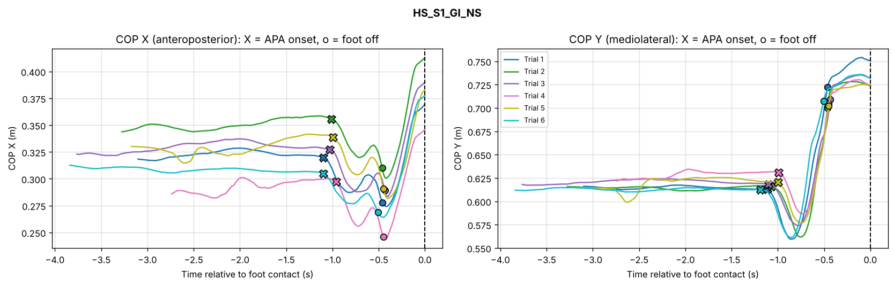

# Gait Initiation Analysis: APA, Braking Index and Margin of Stability

[](https://colab.research.google.com/github/PedroProspero23/gait-initiation-analysis/blob/main/gait_initiation_analysis.ipynb)

A Python pipeline for the biomechanical analysis of **gait initiation** from force-platform and motion-capture data (Qualisys/QTM text export). It detects the main temporal events of gait initiation and extracts classical variables of postural control and dynamic stability, which are used in clinical populations (e.g., Parkinson's disease) and in healthy controls.



## Run it

Click **Open in Colab**, then select **Runtime → Run all**. The sample file is downloaded automatically.

To run it locally:

```bash
pip install -r requirements.txt
jupyter notebook gait_initiation_analysis.ipynb
```

## Method

1. **Import** the QTM export: trials side by side, 27 columns per trial (two force plates, COP, heel/toe markers, centre of mass).
2. **Normalise the side of the first step.** Trials starting with the left foot are mirrored on the mediolateral axis.
3. **Detect the events** from the centre of pressure (COP):
   - *APA onset*, mediolateral: last crossing of the local baseline mean − 2 SD before the APA valley
   - *APA onset*, anteroposterior: 5 % of the first COP ramp
   - *Foot off*: start of the stable COP plateau before contact
   - *Foot contact*: first non-zero vertical force on the second platform
4. **Compute the centre-of-mass velocity** by integrating the ground reaction force (Newton's 2nd law).
5. **Export** one Excel file per data file, plus a summary file.

## Outcome variables

| Variable | Description |
|---|---|
| `APA_ML_Duration_s`, `APA_ML_Amplitude_m` | Duration and amplitude of the mediolateral APAs |
| `APA_AP_Duration_s`, `APA_AP_Amplitude_m` | Duration and amplitude of the anteroposterior APAs |
| `Swing_Time_s` | Time from foot off to foot contact |
| `Vx_FO`, `Vy_FO` | CoM velocity at foot off |
| `Motor_Performance_Peak_Vel` | Peak anteroposterior CoM velocity after foot contact |
| `Braking_Index` | Braking of the vertical CoM fall: (V<sub>z,min</sub> − V<sub>z,FC</sub>) / V<sub>z,min</sub> |
| `Margin_of_Stability_cm` | Mediolateral margin of stability at foot contact, from the extrapolated CoM (XCoM) |
| `Step_Width_m` | First-step spatial parameter computed from the COP of both platforms |

## Files

| File | Content |
|---|---|
| `gait_initiation_analysis.ipynb` | Analysis notebook |
| `HS_S1_GI_NS.txt` | Sample data: one healthy participant, 6 trials, de-identified |
| `example_output.png` | COP traces with the detected events for the sample data |

To analyse your own data, put the `.txt` files in the same folder and name them `<GROUP>_<SUBJECT>_GI_<CONDITION>[_<SESSION>].txt` (e.g. `PD_S1_GI_NS_PRE.txt`). Then add each participant's first stepping foot to `SUBJECT_METADATA`, and set `FS_FORCE` to the force-platform sampling frequency of your session.

## Authorship

**Pedro Henrique Pontieri Próspero**, Faculty of Sport, University of Porto (FADEUP)

Developed during a research collaboration with Université Paris-Saclay, under the methodological guidance of [PhD student name].

## References

- Brenière Y, Do MC. When and how does steady state gait movement induced from upright posture begin? *J Biomech*. 1986;19(12):1035–1040. doi:10.1016/0021-9290(86)90120-X
- Chastan N, Do MC, Bonneville F, et al. Gait and balance disorders in Parkinson's disease: impaired active braking of the fall of centre of gravity. *Mov Disord*. 2009;24(2):188–195. doi:10.1002/mds.22269
- Hof AL, Gazendam MGJ, Sinke WE. The condition for dynamic stability. *J Biomech*. 2005;38(1):1–8. doi:10.1016/j.jbiomech.2004.03.025
- Yiou E, Caderby T, Delafontaine A, Fourcade P, Honeine JL. Balance control during gait initiation: state-of-the-art and research perspectives. *World J Orthop*. 2017;8(11):815–828. doi:10.5312/wjo.v8.i11.815

## License

MIT. See [LICENSE](LICENSE). If you use this code, please cite it (see [CITATION.cff](CITATION.cff)).
